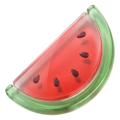

<p align="center">
  
</p>

<h1 align="center">Anguria Studio</h1>

<p align="center">
  A small studio making free, open-source apps for Mac.<br>
  This repository is home to anguria.studio.
</p>

<p align="center">
  <a href="https://anguria.studio">Website</a> &middot;
  <a href="#apps">Apps</a> &middot;
  <a href="#development">Development</a> &middot;
  <a href="mailto:hello@anguria.studio">Contact</a>
</p>

## Apps

<table>
  <tr>
    <td width="50%" valign="top">
      <a href="https://anguria.studio/paguro/">
        
      </a>
      <p align="center">
        <a href="https://anguria.studio/paguro/">Explore Paguro</a> &middot;
        <a href="https://github.com/anguria-studio/Paguro">Source code</a>
      </p>
    </td>
    <td width="50%" valign="top">
      <a href="https://anguria.studio/moppo/">
        
      </a>
      <p align="center">
        <a href="https://anguria.studio/moppo/">Explore Moppo</a> &middot;
        <a href="https://github.com/anguria-studio/Moppo">Source code</a>
      </p>
    </td>
  </tr>
</table>

## Development

Built with Next.js, React, TypeScript, and Tailwind CSS. Available in English,
Italian, French, and Spanish.

Use Node.js 22.18+ and the pnpm version pinned in `package.json`.

```sh
pnpm install
pnpm dev
```

Open [localhost:3000](http://localhost:3000). `pnpm build` exports the static site
to `out/`.

Run checks before opening a pull request:

```sh
pnpm lint
pnpm exec tsc --noEmit
node --test tests/*.test.mjs
```

Site copy lives in `lib/dictionaries/`, app links in `lib/apps.ts`, and images
in `public/`. See [Analytics](docs/analytics.md) and
[Moppo assets](docs/moppo-assets.md) for the detailed setup notes.

The [Paguro test page](https://anguria.studio/paguro/test-notifications/) lets
you try notifications, downloads, and camera access without a messaging account.

## License

[MIT](LICENSE) · [hello@anguria.studio](mailto:hello@anguria.studio)
